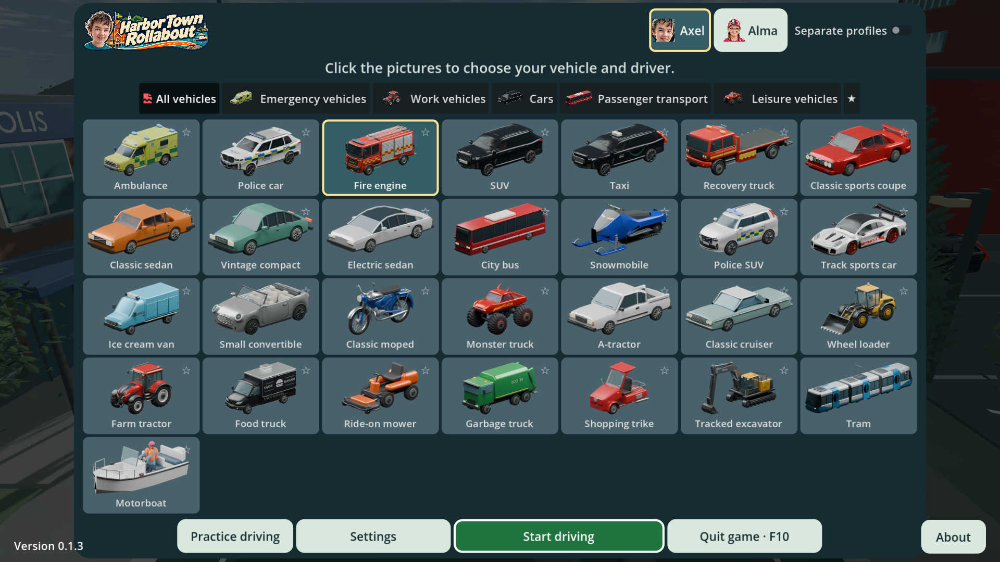

# Harbor Town Rollabout

Choose Axel or Alma and explore a waterfront neighbourhood inspired by Hammarby Sjöstad in Stockholm. Drive a bus, collect the bins or leave your vehicle at the quay and take the ferry. You can follow a job or just see where the road goes.

## Download and play

Choose the download for your computer.

| Platform | Download | Launch |
| --- | --- | --- |
| Windows (x64) | [Windows installer](https://github.com/yeager/harbortownrollabout/releases/download/v0.1.3-binaries.20261123/harbortown-0.1.3-windows-x64.exe) | Run the installer, choose your language, then open **harbortown** from the Start menu. |
| Mac with Apple Silicon (M-series) | [Apple Silicon DMG](https://github.com/yeager/harbortownrollabout/releases/download/v0.1.3-binaries.20261123/harbortown-macos-arm64.dmg) | Open the disk image and drag **harbortown** into **Applications**. |
| Mac with an Intel processor | [Intel Mac DMG](https://github.com/yeager/harbortownrollabout/releases/download/v0.1.3-binaries.20261123/harbortown-macos-x86_64.dmg) | Open the disk image and drag **harbortown** into **Applications**. |
| Ubuntu or Debian (Intel or AMD, 64-bit) | [DEB package](https://github.com/yeager/harbortownrollabout/releases/download/v0.1.3-binaries.20261123/harbortown_0.1.3_amd64.deb) | Install the package, then open **harbortown** from your apps. |
| Fedora (Intel or AMD, 64-bit) | [RPM package](https://github.com/yeager/harbortownrollabout/releases/download/v0.1.3-binaries.20261123/harbortown-0.1.3-1.x86_64.rpm) | Install the package, then open **harbortown** from your apps. |
| Linux x86-64 | [Linux tar.gz](https://github.com/yeager/harbortownrollabout/releases/download/v0.1.3-binaries.20261123/harbortown-linux-x86_64.tar.gz) | Extract the archive, then run `./harbortown` from that folder. |

On a Mac, open **Apple menu → About This Mac** if you’re unsure which download to choose. If you see an M-series chip, choose Apple Silicon. The Windows and Mac downloads are preview builds awaiting tests on those systems.

## Your first drive

Click a vehicle picture, choose Axel or Alma, then select **Start driving**. Hold **W** to move, steer with **A** and **D**, and press **S** to brake. The arrow keys work too. If you prefer the mouse, hold the left button to drive and move the mouse sideways to steer. **R** brings you back to a safe spot if you get stuck.

Choose **Practice driving** on the main menu to try the controls on a traffic-free course. If you get stuck there, **R** returns you to a safe spot on the course. Select **Return to town** when you’re ready to explore.

At a traffic light, stop on red, slow down on orange and go on green. By default, the game helps you stop at the line. If you enable **Allow driving through red lights** in Driving settings, crossing on red brings up a reminder.

**Gentle driving** keeps most vehicles below 30 km/h. With it on, you can complete a pickup or delivery by stopping at the marker. Open the phone with **T** to read where to go next.

## Things to try

- **Drive bus 74 to Sickla udde.** Pick up your first passengers at the square and drop them off at the school. The display inside the bus shows the next stop.
- **Take the garbage truck on its rounds.** Empty the bins at the square and the clinic, then unload at the marina. A full truck takes longer to get moving.
- **Return the ice cream crates.** In **Free exploration**, stop the ice cream van outside the kiosk on Stationsallén to collect two empty crates. Drive west along the same street and park in the bay marked **Ice cream depot**.
- **Make the morning flour run.** Choose the tow truck in **Free exploration** and set the clock to **Day and night**. Stop beside the square between 5 a.m. and noon to load three flour sacks. Stop outside the bakery opposite the fire station to unload them. Your delivery receipt is in the phone.
- **Bring a cake to a birthday party.** Walk up to the pink box at the bakery door and carry it to the party table in the square. The host opens the lid when you arrive.
- **Find the moon rabbit.** Look on the pavement outside the sweet shop. Carry the lost figurine to the counter in the clothing shop to hear the owner's thank-you.
- **Spend your first coins.** Park near Stationsallén, press **F** to get out, then walk to the pizzeria or sweet shop. Use **Tab** to choose what you want and **Enter** to buy it.
- **Play boule by the canal.** Follow the signs from the ferry to the gravel court. Press **F** by the throwing circle to join. On your turn, aim with **←** or **→**, use **Tab** to choose a short, medium or long throw, then press **Enter** to throw. Try to land closest to the small yellow ball.
- **Cross the canal on Lotten.** Walk down the steps to a landing. When the ferry pulls alongside, press **F** to board. Press **F** during the crossing to get off at the next landing.

## Around town

| Bus 74 by the school | Garbage truck passing the fuel station |
| --- | --- |
|  |  |
| **Crossing the high bridge** | **Riding past Västra torget** |
|  |  |

**Cutting the grass at the picnic meadow**

## While you play

| To do this | Press |
| --- | --- |
| Get in or out of a vehicle | F (or enable F3 in Driving settings) |
| Return to a safe spot if you get stuck on foot or in a vehicle | R |
| Help at a mission stop | Space |
| Jump on foot | E |
| Raise or lower the camera on foot | Page Up or Page Down |
| Open the phone | T |
| Turn the radio on or off | J |
| Skip to the next song, when available | N |
| Pause or resume | P (or enable F7 in Driving settings) |
| Quit | F10 (or F8 in Driving settings), then confirm |

Under **Settings → Driving**, you can choose Backspace for recovery, 0 for jumping, 9 and 3 for camera height, or F2 for the phone.

In **Free exploration**, press **F5** or click **Town map**, then click a place or press its number (1–8). Press **F5** again to close the map and keep your current destination. For the hot dog stand, choose **6**, park nearby and follow the arrows on foot to the counter.

The radio switches on when you enter a vehicle. It plays songs in your chosen language. If there are none yet, it plays English songs.

The game starts in your system language and falls back to English. To change it, open **Settings** and select the globe. You can also change the weather and season there.

Daniel Nylander made Harbor Town Rollabout for his children. Its Swedish title is **Full rulle i Sjöstaden**.

## Play from source

Open `project.godot` in Godot 4.7 dev5 and press **F5**.

## Help out

Can you sing a radio song in your language, improve a translation or take a test drive? [See how to contribute](CONTRIBUTE.md).

## License

Harbor Town Rollabout is licensed under the [GNU General Public License, version 3 only](LICENSE) (GPL-3.0-only). Third-party components retain their respective licenses.
