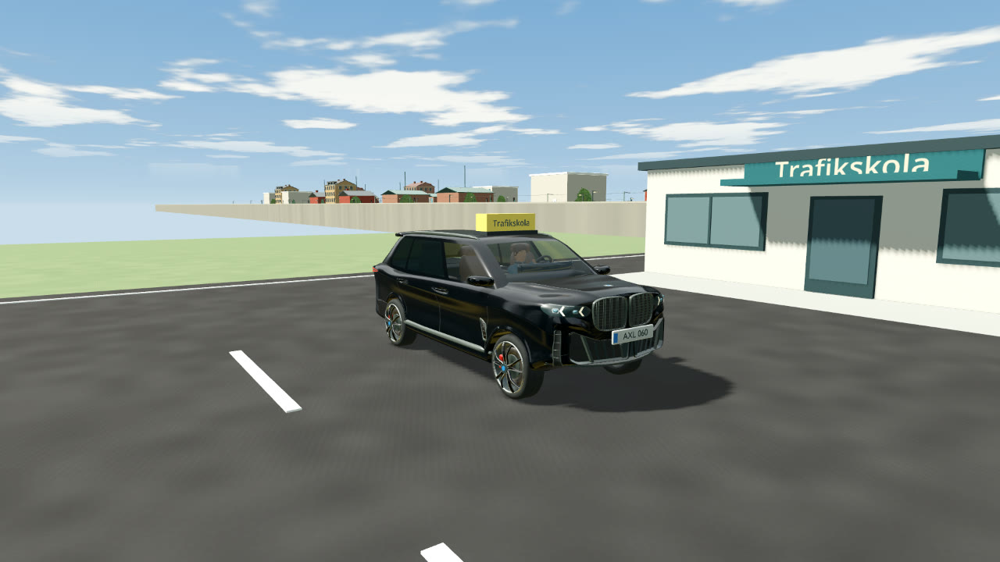
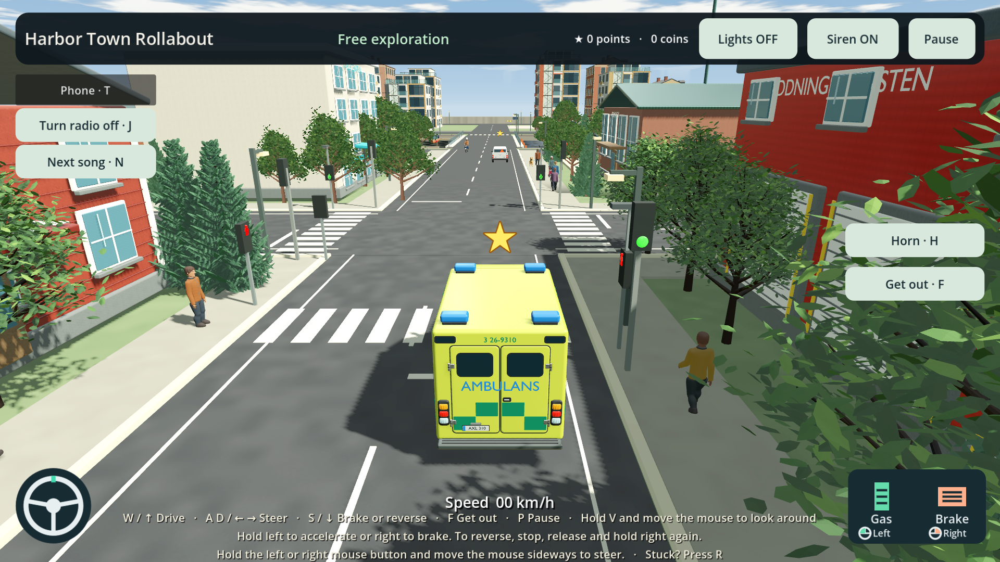
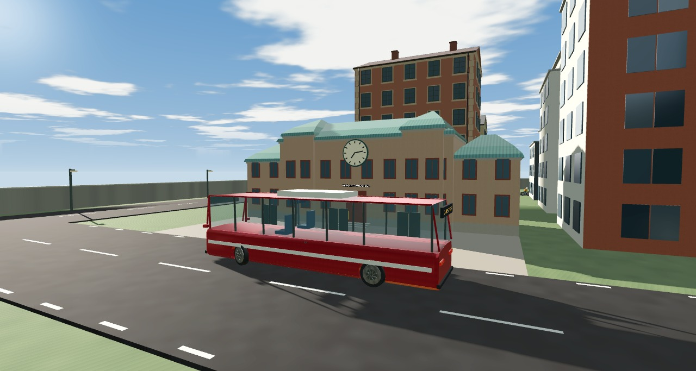
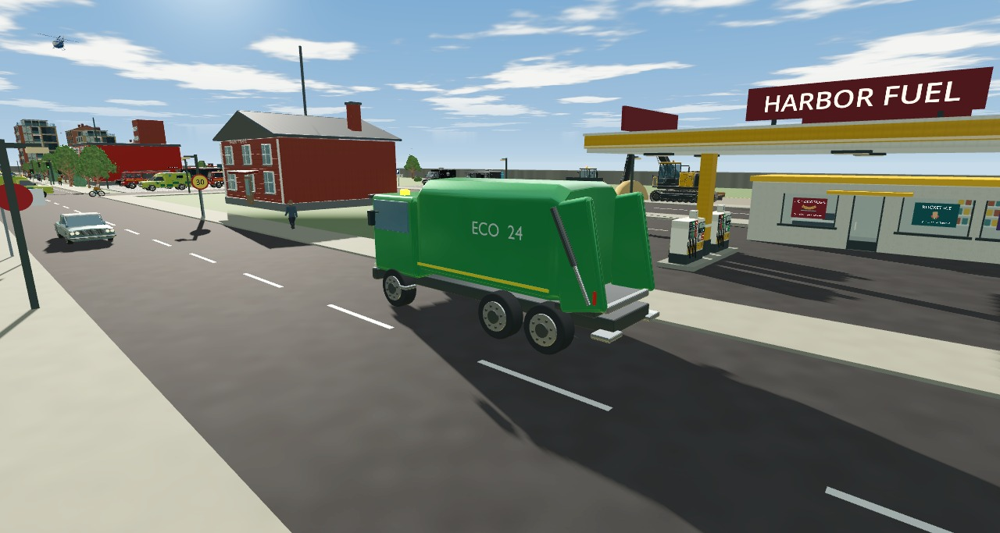
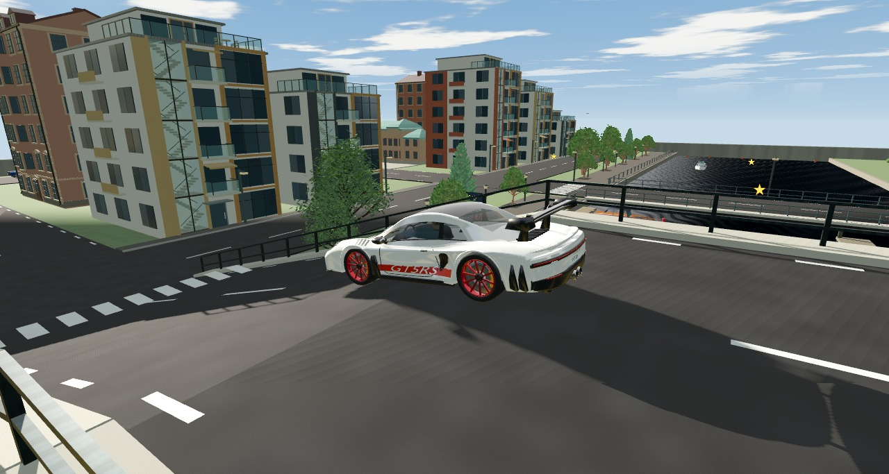
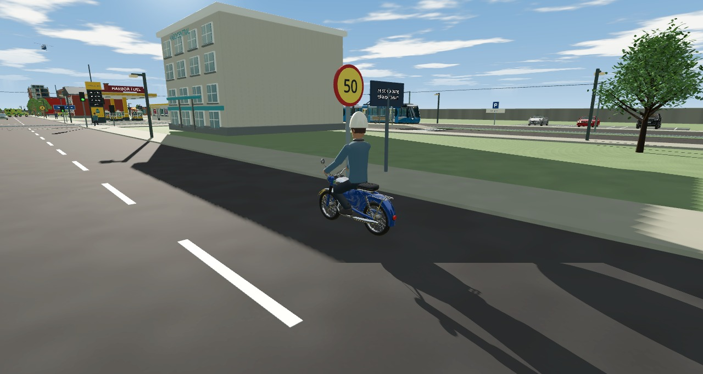
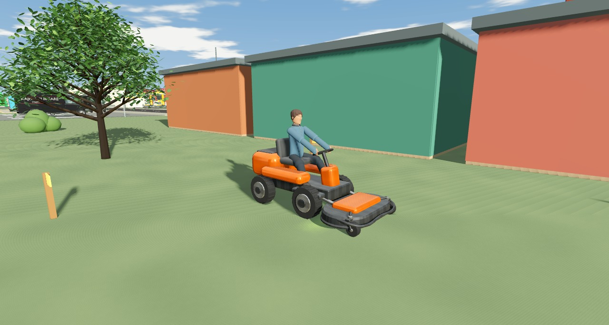

# Harbor Town Rollabout

Choose Axel or Alma and explore a waterfront neighbourhood inspired by Hammarby Sjöstad in Stockholm. Drive a bus, collect the bins or leave your vehicle at the quay and take the ferry. You can follow a job or just see where the road goes.

## Download and play

Choose the download for your computer.

| Platform | Download | Launch |
| --- | --- | --- |
| Windows (x64) | [Windows installer](https://github.com/yeager/harbortownrollabout/releases/download/v0.1.3-ci.8/harbortown-0.1.3-ci.8-windows-x64.exe) | Run the installer, choose your language, then open **harbortown** from the Start menu. |
| Mac with Apple Silicon (M-series) | [Apple Silicon DMG](https://github.com/yeager/harbortownrollabout/releases/download/v0.1.3-ci.8/harbortown-0.1.3-ci.8-macOS-arm64.dmg) | Open the disk image and drag **harbortown** into **Applications**. |
| Mac with an Intel processor | [Intel Mac DMG](https://github.com/yeager/harbortownrollabout/releases/download/v0.1.3-ci.8/harbortown-0.1.3-ci.8-macOS-x86_64.dmg) | Open the disk image and drag **harbortown** into **Applications**. |
| Ubuntu or Debian (Intel or AMD, 64-bit) | [DEB package](https://github.com/yeager/harbortownrollabout/releases/download/v0.1.3-ci.8/harbortown-0.1.3-ci.8-x86_64.deb) | Install the package, then open **harbortown** from your apps. |
| Fedora (Intel or AMD, 64-bit) | [RPM package](https://github.com/yeager/harbortownrollabout/releases/download/v0.1.3-ci.8/harbortown-0.1.3-ci.8-x86_64.rpm) | Install the package, then open **harbortown** from your apps. |
| Linux x86-64 | [Linux tar.gz](https://github.com/yeager/harbortownrollabout/releases/download/v0.1.3-ci.8/harbortown-0.1.3-ci.8-linux-x86_64.tar.gz) | Extract the archive, then run `./harbortown` from that folder. |

On a Mac, open **Apple menu → About This Mac** if you’re unsure which download to choose. If you see an M-series chip, choose Apple Silicon. These are preview builds. The Windows installer and both Mac downloads pass an automated start check on their respective systems.

## Gamepad

Connect a gamepad recognized by your system. Use the **D-pad** and the **bottom face button** (A on Xbox, Cross on PlayStation) to navigate and confirm in menus. Use the **left stick** to walk or steer and the **right stick** to adjust the camera. In a vehicle, the **right trigger** accelerates and the **left trigger** brakes. Release the left trigger after stopping, then press it again to reverse a road vehicle.

The **left face button** (X / Square) enters or exits a vehicle, the **top face button** (Y / Triangle) switches camera view, and the **right shoulder button** sounds the horn. On foot, press the **right face button** (B / Circle) to jump or the **bottom face button** for the current mission action. While driving, **B / Circle** toggles the siren or engine sound, and the **left shoulder button** toggles emergency lights on equipped vehicles. **Start / Options** pauses or resumes. **Back / Share** opens or closes the phone. Click the **left stick** to unfold or put away the scooter, and click the **right stick** to open the town map in free drive. Close it with B / Circle or by clicking the right stick again. Holding the **left shoulder button** while walking forward makes the character run.

Open **Settings → Gamepad** to adjust the stick dead zone, camera speed and vertical camera direction. In Settings, use the **shoulder buttons** to switch tabs and the **D-pad** to change sliders.

In the excavator, hold the **left shoulder button** to control the arm. Move the **right stick** sideways to turn the cab and vertically to raise or lower the boom. Move the **left stick** vertically to move the outer arm and sideways to tilt the bucket. Release the shoulder button to return to track and camera controls. Release and press the trigger again if you held it while operating the arm.

## Your first drive

Click a vehicle picture, choose Axel or Alma, then select **Start driving**. Hold **W** to move, steer with **A** and **D**, and press **S** to brake. The arrow keys work too. If you prefer the mouse, hold the left button to drive and move the mouse sideways to steer. **R** brings you back to a safe spot if you get stuck.

Choose **Practice driving** on the main menu to start in a marked driving-school car on a traffic-free course. Practise staying within 20 km/h, stopping at the STOP sign and waiting for green. If you get stuck there, **R** returns you to a safe spot on the course. Select **Return to town** when you’re ready to explore.

On snowy roads, a sharp turn above about 22 km/h can make a vehicle slide sideways and leave tyre marks. Ease off and straighten the wheel to regain grip. Ploughed lanes also give the tyres more grip. Drive the farm tractor forward in winter snow to plough and spread grit and salt. Other vehicles get extra grip on the treated strip. Use the **Spreader on/off** button to keep ploughing without spreading. To toggle the spreader with **7** on the main keyboard or number pad, enable the numbered vehicle shortcuts under **Settings → Driving**.

At a traffic light, stop on red, slow down on orange and go on green. By default, the game helps you stop at the line. If you enable **Allow driving through red lights** in Driving settings, crossing on red brings up a reminder. If a police car is nearby, it stops you at the line for up to three seconds or until the light turns green. If you stay stopped after the light turns green, cars queued directly behind you may honk until you move.

Turn indicators come on automatically as you steer. Look for blue **P** signs on Stationsallén, Norra kajgatan and Södra kajgatan, then park parallel to the kerb with the whole vehicle inside a white box.

The A-tractor tops out at 30 km/h. Cars may honk if they get stuck behind it.

Wait before a junction if there’s a queue on the other side. When you drive an ambulance, police car or fire engine with its blue lights or siren on, traffic gives way where there’s room. You can proceed on red once the crossing is clear.

**Gentle driving** keeps most vehicles below 30 km/h. With it on, you can complete a pickup or delivery by stopping at the marker. Open the phone with **T** to read where to go next.

## Things to try

- **Stop at Dax.** Select Dax on the town map and follow the drive-through arrows. Stop at the speaker to order, then drive around to the pickup window. A burger costs eight coins.

- **Bring a patient to the hospital.** Take an ambulance assignment and collect the patient at the square. Follow the arrows to the covered ambulance bay on Östra allén, drive inside and stop. The drop-off receipt appears on your phone. Look up to see the air ambulance land on the roof.
- **Drive bus 74 to Sickla udde.** Pick up your first passengers at the square and drop them off at the school. The display inside the bus shows the next stop.
- **Take the garbage truck on its rounds.** Empty the bins at the square and the clinic, then unload at the marina. A full truck takes longer to get moving.
- **Return the ice cream crates.** In **Free exploration**, stop the ice cream van outside the kiosk on Stationsallén to collect two empty crates. Drive west along the same street and park in the bay marked **Ice cream depot**.
- **Change tyres at the garage.** Select **Fuel and tyre service** on the town map, stop beside the **Tyre service** sign and choose which tyres to fit. Summer tyres slide more and take longer to stop on snow. The game remembers the tyres fitted to each vehicle.
- **Drive the Sport Kvattro from inside.** Choose **Audo Sport Kvattro** under **Cars** and press **C** to switch between the left-hand driver’s seat and the outside camera.
- **Deliver parcels in the DAM pickup.** Choose the pickup under **Work vehicles**, open the phone with **T** and select **Take a job**. Pick up two parcels at the square and watch them ride in the bed. Deliver them to the health centre and marina. Open **Delivery receipts** on the phone to read either receipt again.
- **Make the morning flour run.** Choose the tow truck in **Free exploration** and set the clock to **Day and night**. Stop beside the square between 5 a.m. and noon to load three flour sacks. Stop outside the bakery opposite the fire station to unload them. Your delivery receipt is in the phone.
- **Bring a cake to a birthday party.** Walk up to the pink box at the bakery door and carry it to the party table in the square. The host opens the lid when you arrive.
- **Find the moon rabbit.** Look on the pavement outside the sweet shop. Carry the lost figurine to the counter in the clothing shop to hear the owner's thank-you.
- **Spend your first coins.** Park near Stationsallén, press **F** to get out, then walk to the pizzeria or sweet shop. Use **Tab** to choose what you want and **Enter** to buy it.
- **Visit the villa district.** Choose **Villa district** on the town map to find the houses beside the tram tracks on Verkstadsgatan. The arrows lead into an empty driveway. Set the season to **Winter** and the time to **Night** to see the lights along the roofs, fences and garden trees.
- **Visit Toy Harbour.** Find the shop on the town map or walk along Stationsallén past the hot dog stand. The window displays a wooden train, building blocks and a teddy bear. You can buy all three inside.
- **Play boule by the canal.** Follow the signs from the ferry to the gravel court. Press **F** by the throwing circle to join. On your turn, aim with **←** or **→**, use **Tab** to choose a short, medium or long throw, then press **Enter** to throw. Try to land closest to the small yellow ball.
- **Drive the Tvärbanan tram.** Press **F** while driving to request to get off, then drive to the next station. You step onto the platform when the doors open.
- **Cross the canal on Lotten.** Walk down the steps to a landing. When the ferry pulls alongside, press **F** to board. Press **F** during the crossing to get off at the next landing.
- **Take the motorboat.** Choose **Motorboat** on the town map and follow the arrows to the wooden pier on the east quay. Press **F** to board or step ashore when the boat is stopped at the pier. While driving the boat, press **R** to return to its berth.

## Around town

| Bus 74 by the school | Garbage truck passing the fuel station |
| --- | --- |
|  |  |
| **Crossing the high bridge** | **Riding past Västra torget** |
|  |  |

**Cutting the grass at the picnic meadow**

[Browse the full vehicle gallery](examples/README.md).

## While you play

| To do this | Press |
| --- | --- |
| Get in or out of a vehicle | F (or enable F3 in Driving settings) |
| Return to a safe spot if you get stuck on foot or in a vehicle | R |
| Help at a mission stop | Space |
| Jump on foot | E |
| Raise or lower the camera on foot | Page Up or Page Down |
| Open the phone | T |
| Turn the radio on or off | J |
| Skip to the next song, when available | N |
| Pause or resume | P (or enable F7 in Driving settings) |
| Quit | F10 (or F8 in Driving settings), then confirm |

Under **Settings → Driving**, you can choose Backspace for recovery, 0 for jumping, 9 and 3 for camera height, or F2 for the phone.

In **Free exploration**, press **F5** or click **Town map**. Click a place, use **Tab** and **Enter**, or press the shortcut for a destination numbered **0–9**. Press **F5** again to close the map and keep your destination. For the pizzeria, choose **9** and walk through the door. For the hot dog stand, choose **6**, park nearby and follow the arrows on foot to the counter.

The radio switches on when you enter a vehicle. It plays songs in your chosen language. If there are none yet, it plays English songs.

The game starts in your system language and falls back to English. To change it, open **Settings** and select the globe. You can also change the weather and season there. Turn on **Show more of the city in the distance** in Settings if you want to see farther down long streets. Turn off **Streetlamp shadows** for smoother driving at night. Streetlamps still light the road.

Daniel Nylander made Harbor Town Rollabout for his children. Its Swedish title is **Full rulle i Sjöstaden**.

## Play from source

Open `project.godot` in Godot 4.7 dev5 and press **F5**.

## Help out

Can you sing a radio song in your language, improve a translation or take a test drive? [See how to contribute](CONTRIBUTE.md).

## License

Harbor Town Rollabout is licensed under the [GNU General Public License, version 3 only](LICENSE) (GPL-3.0-only). Third-party components retain their respective licenses.
