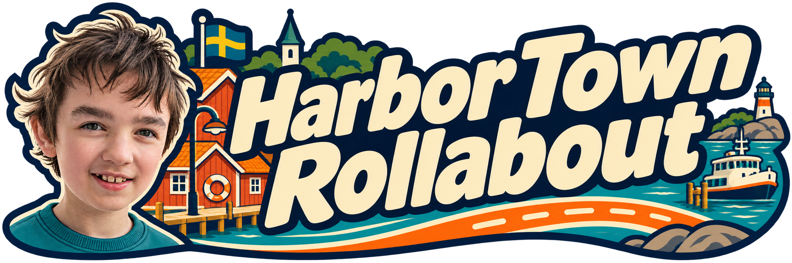
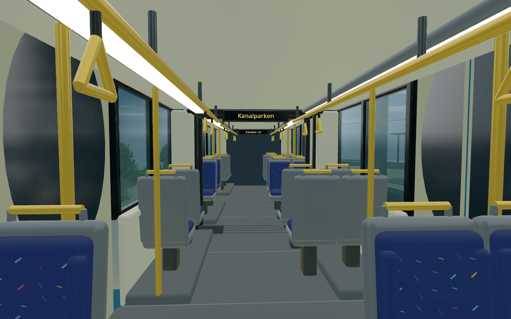
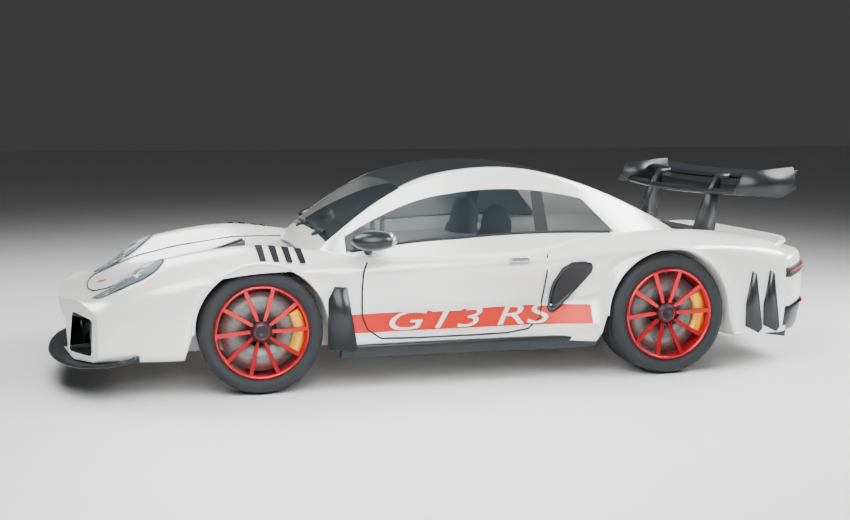

# Harbor Town Rollabout

**Full rulle i Sjöstaden** is the Swedish title of this family driving and exploration game by Daniel Nylander.

Explore a 3D waterfront neighbourhood inspired by Hammarby Sjöstad in Stockholm. Choose Axel or Alma and drive through town, cross the canal by motorboat or ride the tram. Your vehicle determines the jobs you receive, from emergency calls and school taxi trips to roadside recovery. You can also explore at your own pace.

## Downloads

The [Linux preview](https://github.com/yeager/harbortownrollabout/releases/tag/v0.1.3-preview.20261123) runs on x86-64 systems with glibc 2.44 or newer. Choose a download for your system:

- [Debian or Ubuntu (.deb)](https://github.com/yeager/harbortownrollabout/releases/download/v0.1.3-preview.20261123/axels-spel_0.1.3-preview.20261123_amd64.deb)
- [Fedora or another RPM-based distribution (.rpm)](https://github.com/yeager/harbortownrollabout/releases/download/v0.1.3-preview.20261123/axels-spel-0.1.3-preview.20261123-1.x86_64.rpm)
- [Portable archive (.tar.gz)](https://github.com/yeager/harbortownrollabout/releases/download/v0.1.3-preview.20261123/harbortownrollabout-0.1.3-preview.20261123-linux-x86_64.tar.gz). Extract both files into one folder and run `./axels-spel` there.

For Windows and macOS, see **Play from source** below. The package workflow also targets a Windows x64 installer in seven languages and a universal macOS disk image.

Pushing a version tag such as `v1.2.3` builds a release. Running **Game packages** manually builds a prerelease. The [DEB mirror](https://github.com/yeager/deb-repo/releases?q=harbortownrollabout) and [RPM mirror](https://github.com/yeager/rpm-repo/releases?q=harbortownrollabout) check hourly and copy their respective package and the portable archive into GitHub Releases.

## Play from source

Clone this repository, then open `project.godot` in Godot 4.7 dev and press **F5**. Select a vehicle and choose **Start driving**.

On first launch, the game uses your system language if supported, with English as the fallback. To switch languages, open **Settings** and select the tab with the globe. Choose **Deutsch**, **English**, **Español**, **Français**, **Norsk bokmål**, **Suomi** or **Svenska**. The game switches immediately and remembers your choice next time.

| Action | Control |
| --- | --- |
| Accelerate | W, Up arrow or left mouse button |
| Steer | A/D, Left/Right arrows, or move the mouse sideways while holding the accelerator or brake mouse button |
| Brake | S, Down arrow or right mouse button |
| Reverse | Stop, release the brake, then press S, Down or the right mouse button again |
| Help at a mission marker | Space |
| Leave or enter a parked vehicle | F |
| Open or close the phone | T |
| Close the open phone and return to play | Escape |
| Toggle the vehicle radio | J |
| Next radio song | N |
| Pause | P, or Escape when the phone is closed |
| Quit the game | F10, then choose **Yes** to quit or **No** to return |

Gentle driving limits ordinary vehicles to 30 km/h and completes an interaction when you stop at the marker. The steering wheel and pedals on screen show your inputs. You can adjust volume and emergency lights independently, choose daylight or night, or let a full day pass in six minutes of active play.

## Project files

Godot loads the playable world from `main.tscn`. Vehicle meshes are in `vehicles/`, buildings and vegetation in `environment/`, and editable Blender scenes in `source_blender/`. The Python scripts in `tools/` generate models and audio. Translation catalogs and the [guide to adding a language](l10n/README.md) live in `l10n/`.

## Tvärbanan

The tram runs at street level through the western district on a 685 m loop with four stops. Traffic runs in opposite directions on either side of the tracks. At the six crossings, red signals hold the tram and road traffic while pedestrians have a green walking figure. Walk onto a platform and press **F** when the doors open to board. Press **F** at a stop to get off. To drive the tram yourself, choose the **Tram** picture on the start menu and press **Drive the tram**. Use W and S or the arrow keys to control its speed. Steering follows the rails, and the tram stops at each platform for six seconds. The lead car carries a Swedish notice beside a blue door.
Passengers look out from the middle carriage. Hold the middle mouse button and drag to look around. The amber display above the aisle shows the next stop.

## Weather and exploration

In **Settings**, you can choose the season and weather independently. For example, select Winter and leave the weather on Automatic to get changing conditions throughout a winter session. Automatic seasons last 30 minutes of active play, and automatic forecasts change every five minutes.

Clouds gather before rain or snow starts. Manual weather changes follow the same gradual transitions. Switch back to Automatic during a shower and it continues until the next forecast. Spring and autumn can bring slush, which leaves both water and snow on the ground. Wet and snowy roads increase braking distance. Daylight includes a visible sun aligned with the light casting the street shadows.

Hold **V** and move the mouse for continuous camera control. Release **V** to use the pointer again. You can also hold the middle mouse button and drag to orbit the exterior camera or look around in first person. On the SUV, classic moped and food truck, press **C** to switch between the chase camera and the driver’s view. The moped’s speedometer shows your speed in km/h. Switching back to the driver’s view centres the camera. On foot, nearby neighbours greet you in the selected language. Greetings and the lost-cat and lost-shoe conversations appear in speech bubbles and use bundled voice clips in English, Swedish, Spanish, German, French, Norwegian Bokmål and Finnish.

The central junction has phased traffic lights and red and green pedestrian figures beside the crossing. Traffic waits for its green phase. The player's vehicle also slows as it approaches a red signal, pedestrians in its path or a queue.

Land vehicles slow down at the quay edge in both directions. The two road bridges let you drive between the banks.

The double-ended passenger ferry **Lotten** runs between two landings in the canal. Walk onto either landing and press **F** or select **Board Lotten** when the ferry is alongside. The ferry follows its own route. Look around with the mouse during the crossing. Press **F** underway to request the next landing, or press it again to stay aboard. You can also step ashore with **F** during a stop. Its editable Blender model is in `source_blender/Lotten.blend`.

## Taxi and horns

Choose the **Taxi** picture and press **Start driving**. Open the phone with **T** and accept the assignment to pick up a passenger. Follow the green arrows along the streets and over a bridge when needed. Stop at the marker to board or drop off your fare. Gentle driving handles boarding automatically. The next fare appears after drop-off.

Press **H** or click **Horn** while driving. The ambulance, police car, fire engine, SUV and taxi each have their own horn.

## Motorboat

Choose the **Motorboat** picture on the start menu. The white centre-console boat starts in the southern canal basin. Use the same steering and pedal controls as a car. Hold the brake to slow down and reverse. The shore and buoy lines bound the boating area. Press **H** for the boat horn or drag with the middle mouse button to look around.

A blue-and-white Swedish police helicopter flies a continuous patrol above the waterfront during play. Its main and shrouded tail rotors turn independently. The editable model is in `source_blender/Polishelikopter.blend`.

Two slow, white pickup-converted A-traktors share the main street. Look for the orange triangular reflector on the back of the cab. Faster traffic following one slows down and gives a short horn greeting.

Choose **Axel · 15** or **Alma · 12** beside the vehicle selector. The choice changes the character you see on foot. Each rescue mission step earns 10 coins and completing a taxi fare earns 15. Both characters share one wallet on this installation.

Press **T** or click **Phone** to open the compact phone and read your current assignment above the scrollable SMS history. The inbox holds up to 32 messages, including dispatches, family texts and payment receipts. Press **Escape** to close it and return to play. Changing the language also translates messages you have already received.

## Shops

Park along Stationsallén, south of the vehicle depot, and walk through a shop doorway. The café sells cinnamon buns and berry cordial, the kiosk sells ice cream and hot dogs, and the pizzeria and sweet shop sell pizza and pick-and-mix sweets. The first product is focused when you enter. Press Tab to choose another product and Enter to buy it with mission coins. The game saves the purchase and remaining balance together.

## Roadside recovery

Select **Recovery truck** and the mission activity. Dispatch sends the location of a car with a smoking bonnet or a missing wheel. Look for the warning triangle and amber hazard lights. The hazards follow the traffic light effects setting and switch off when the car is loaded. Stop at the marker beside the car to load it onto the flatbed. Follow the arrows to the workshop and stop to unload and earn 20 coins. Gentle driving handles loading and unloading automatically. In full-speed mode, press Space while stopped.

The police station stands on the north side of the western main street. Cross the northern bridge to find Sjöstads Sjukhus and its covered emergency entrance. The hospital and neighbourhood clinic are distinct buildings.

People wear scarves in spring and autumn, knit caps and scarves in winter or snow, and brimmed hats and storm collars in rain. Their steps follow their speed, and the player places each foot on the waterfront stairs.

Along the main street, a neighbour pushes a green pram near the police station and an older pedestrian walks with a four-wheel rollator near the square. They turn around at the ends of their pavement stretches.

Two sea-green 1960s-style cruisers with ivory roofs drive along the main street. They weave gently within their lanes and stop behind other vehicles.

Between the two bridges, leave your vehicle on the western bank and take the steps down to the timber boardwalk. Follow the rope railing between Lotten’s two landings and take the other staircase back up to the street.

During the rescue route, the medic hands over a green first-aid bag. It travels inside the vehicle, appears in the player's hand on foot and stays on the quay after delivery.

## Electric kick scooter

On foot outdoors, press **U** to unfold the scooter on clear ground. **W / Up** accelerates, **S / Down** brakes and **A / D** steers. Press **U** or **F** to step off and fold it. Axel and Alma can both ride. Look for another rider on the pavement west of the square.

## School trips, buses and passenger cars

Choose **City bus** and start **Bus route 502** to pick up passengers at the square and drop them off at Sjöstadsskolan. The next service runs from the marina to the clinic. Stop at the marker to serve each stop in gentle mode, or press Space while stationary in manual mode. Each completed journey pays 15 coins.

The taxi rotation also includes a pupil travelling from the square to school and a pupil waiting outside school for a ride to the clinic. Follow the arrows to the yellow **TAXI** sign outside Sjöstadsskolan. With gentle driving enabled, stop at the marker for about a second to let the pupil board or get out. Read the next request on the phone.

The vehicle selector and depot include a red classic sports coupe, orange classic sedan, green vintage compact and white electric sedan. Full-speed mode gives the two classic family cars relaxed acceleration. The electric sedan has a quiet electric motor sound and accelerates quickly.

The track sports car has a separate sport tune. Select it at the depot to drive the wide-body coupe with its recessed front intakes, sculpted bonnet outlets, swan-neck rear wing and twin centre exhausts. Its acceleration under full throttle and its top speed are both three times those of the ordinary taxi in the same mode. It reaches 90 km/h in gentle driving or about 238 km/h in full-speed mode.

The radio starts with a shuffled song when you enter a vehicle. Press **J** to switch it off or on and **N** for the next song. It stops when you step out. The radio shuffles songs in the selected game language. Songs are available in Swedish and English. For the other languages, the disabled radio button displays “No songs yet” in the selected language. Lyrics and links to both recordings of each song are in [the songbook](docs/Radiolatar.md).

## Graphics settings

Open **Settings → Graphics** to choose Compatibility, Mobile, Forward+, or Forward+ with FSR 2.2. Restart the game to apply the selection. Running `./play.sh` uses your saved setting.

### Linux launch options

Run one of the following from the project directory with Godot 4 installed. The launcher prefers the local custom engine when available, then checks `godot4`, `godot`, and the local 4.6.3 fallback. Set `GODOT_BIN` to the path of a specific Godot 4 executable, including a custom build.

| Command | Graphics |
| --- | --- |
| `./play.sh compatibility` | Compatibility / OpenGL, the project default |
| `./play.sh mobile` | Mobile / Vulkan on supported Linux systems |
| `./play.sh forward+` | Forward+ at native resolution |
| `./play.sh fsr2` | Forward+ with AMD FSR 2.2 at 75% internal resolution per axis |

The main scene passed a four-frame startup check with each renderer on Linux using Godot 4.6.3 and AMD Radeon Renoir graphics. Compatibility used OpenGL, while Mobile and Forward+ used Vulkan. This check covers startup only.

In full-speed driving mode, road vehicles can reach twice their former top speed. Gentle driving retains its 30 km/h limit for ordinary vehicles. The western district adds connected street loops, bringing the playable boundary to 690 × 151 metres.
The snowmobile is available in the vehicle selector and at the depot. It uses the same driving and braking controls as the cars.
Off-road, the snowmobile can go faster as snow accumulates. Gentle driving still caps it at 30 km/h.
Bus route 502 serves six stops, including a passenger pickup at Västra torget and a drop-off at Västerängen.
You can also hold the left mouse button directly on either on-screen pedal. Release it anywhere to let the pedal up.

Police patrols, fire safety checks, ambulance calls, taxi fares, towing and bus routes depend on your vehicle. Personal cars deliver parcels and the snowmobile delivers blankets. Switching vehicles during a session preserves your place in each vehicle's jobs. The phone also receives occasional family texts during play.

At the kiosk, buy an ice cream or a hot dog, then choose the matching **Eat** button. Axel or Alma consumes one snack and feels extra happy for 25 seconds of play.
On foot, hold Page Up to raise the camera or Page Down to lower it. With the phone open, use Page Up or Page Down to read your messages. Home returns to the current job and End jumps to the oldest visible message.
